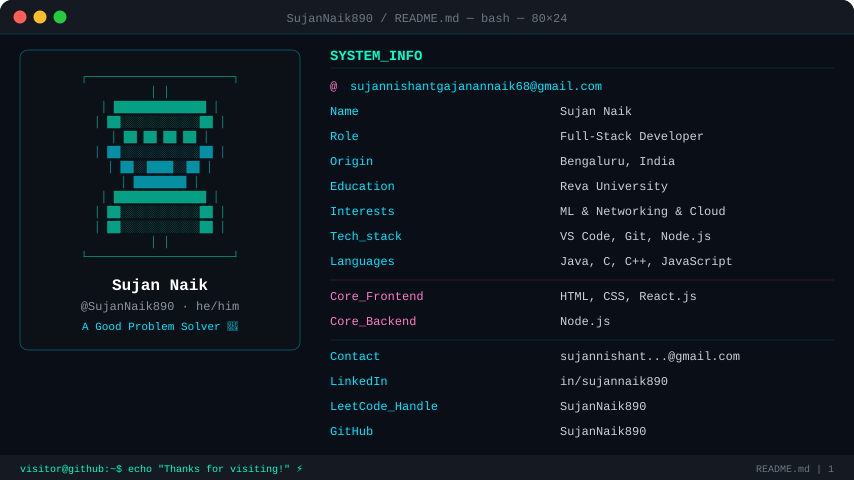

<!-- SujanNaik890 · GitHub Profile README -->

<table align="center">
<tr><td colspan="2" align="left">

&nbsp; 🔴 &nbsp; 🟡 &nbsp; 🟢 &nbsp;&nbsp; **SujanNaik890** / **README** .md

</td></tr>
<tr>
<td valign="top" width="35%" align="center">

 

 

</td>
<td valign="top" width="65%">

</td>
</tr>
</table>

 

<!-- ══════ STATS + LANGUAGES ══════ -->

  
  &nbsp;
  

 

<!-- ══════ CONTRIBUTION HEATMAP (colored squares grid) ══════ -->

  

 

<!-- ══════ PINNED REPOS (2×2 grid) ══════ -->

  
  

  
  

