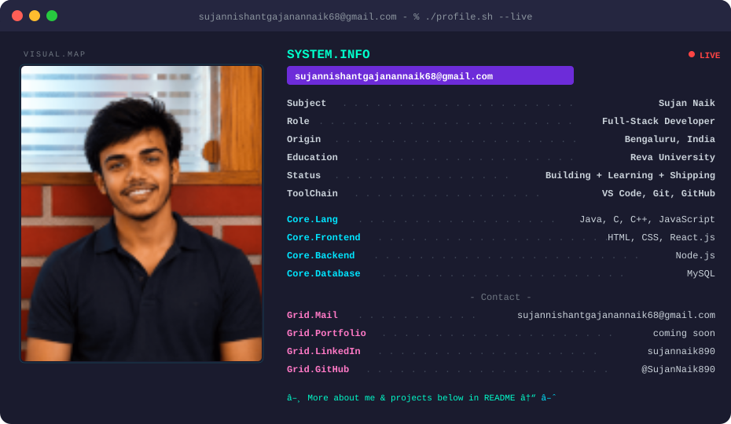

<!-- SujanNaik890 · GitHub Profile README -->

<!-- ══════ TERMINAL CARD (Dark/Light auto-switch) ══════ -->

  <picture>
    <source media="(prefers-color-scheme: dark)" srcset="./terminal-dark.svg"/>
    <source media="(prefers-color-scheme: light)" srcset="./terminal-light.svg"/>
    
  </picture>

 

<!-- ══════ GITHUB STATS + LANGUAGES ══════ -->

  <picture>
    <source media="(prefers-color-scheme: dark)" srcset="https://github-readme-stats.vercel.app/api?username=SujanNaik890&show_icons=true&hide_border=true&bg_color=0d1117&title_color=00ffcc&icon_color=00e5ff&text_color=c9d1d9&count_private=true&include_all_commits=true&ring_color=00e5ff"/>
    <source media="(prefers-color-scheme: light)" srcset="https://github-readme-stats.vercel.app/api?username=SujanNaik890&show_icons=true&hide_border=true&bg_color=ffffff&title_color=0969da&icon_color=0969da&text_color=24292f&count_private=true&include_all_commits=true&ring_color=0969da"/>
    
  </picture>
  &nbsp;
  <picture>
    <source media="(prefers-color-scheme: dark)" srcset="https://github-readme-stats.vercel.app/api/top-langs/?username=SujanNaik890&layout=donut&hide_border=true&bg_color=0d1117&title_color=00ffcc&text_color=c9d1d9"/>
    <source media="(prefers-color-scheme: light)" srcset="https://github-readme-stats.vercel.app/api/top-langs/?username=SujanNaik890&layout=donut&hide_border=true&bg_color=ffffff&title_color=0969da&text_color=24292f"/>
    
  </picture>

 

<!-- ══════ CONTRIBUTION HEATMAP ══════ -->

  <picture>
    <source media="(prefers-color-scheme: dark)" srcset="https://ghchart.rshah.org/00e5ff/SujanNaik890"/>
    <source media="(prefers-color-scheme: light)" srcset="https://ghchart.rshah.org/0969da/SujanNaik890"/>
    
  </picture>

 

<!-- ══════ ACTIVITY GRAPH ══════ -->

  <picture>
    <source media="(prefers-color-scheme: dark)" srcset="https://github-readme-activity-graph.vercel.app/graph?username=SujanNaik890&bg_color=0d1117&color=00ffcc&line=00e5ff&point=ff79c6&area=true&hide_border=true&area_color=7b2ff7"/>
    <source media="(prefers-color-scheme: light)" srcset="https://github-readme-activity-graph.vercel.app/graph?username=SujanNaik890&bg_color=ffffff&color=0969da&line=0969da&point=8250df&area=true&hide_border=true&area_color=ddf4ff"/>
    
  </picture>

 

<!-- ══════ PINNED REPOS ══════ -->

  <a href="https://github.com/SujanNaik890/Leetcodeqns">
    <picture>
      <source media="(prefers-color-scheme: dark)" srcset="https://github-readme-stats.vercel.app/api/pin/?username=SujanNaik890&repo=Leetcodeqns&hide_border=true&bg_color=0d1117&title_color=00ffcc&icon_color=00e5ff&text_color=c9d1d9"/>
      <source media="(prefers-color-scheme: light)" srcset="https://github-readme-stats.vercel.app/api/pin/?username=SujanNaik890&repo=Leetcodeqns&hide_border=true&bg_color=ffffff&title_color=0969da&icon_color=0969da&text_color=24292f"/>
      
    </picture>
  </a>
  <a href="https://github.com/SujanNaik890/DSA_BOMB">
    <picture>
      <source media="(prefers-color-scheme: dark)" srcset="https://github-readme-stats.vercel.app/api/pin/?username=SujanNaik890&repo=DSA_BOMB&hide_border=true&bg_color=0d1117&title_color=00ffcc&icon_color=00e5ff&text_color=c9d1d9"/>
      <source media="(prefers-color-scheme: light)" srcset="https://github-readme-stats.vercel.app/api/pin/?username=SujanNaik890&repo=DSA_BOMB&hide_border=true&bg_color=ffffff&title_color=0969da&icon_color=0969da&text_color=24292f"/>
      
    </picture>
  </a>

  <a href="https://github.com/SujanNaik890/Chatting_Application_java">
    <picture>
      <source media="(prefers-color-scheme: dark)" srcset="https://github-readme-stats.vercel.app/api/pin/?username=SujanNaik890&repo=Chatting_Application_java&hide_border=true&bg_color=0d1117&title_color=00ffcc&icon_color=00e5ff&text_color=c9d1d9"/>
      <source media="(prefers-color-scheme: light)" srcset="https://github-readme-stats.vercel.app/api/pin/?username=SujanNaik890&repo=Chatting_Application_java&hide_border=true&bg_color=ffffff&title_color=0969da&icon_color=0969da&text_color=24292f"/>
      
    </picture>
  </a>
  <a href="https://github.com/SujanNaik890/taxi-booking-platform">
    <picture>
      <source media="(prefers-color-scheme: dark)" srcset="https://github-readme-stats.vercel.app/api/pin/?username=SujanNaik890&repo=taxi-booking-platform&hide_border=true&bg_color=0d1117&title_color=00ffcc&icon_color=00e5ff&text_color=c9d1d9"/>
      <source media="(prefers-color-scheme: light)" srcset="https://github-readme-stats.vercel.app/api/pin/?username=SujanNaik890&repo=taxi-booking-platform&hide_border=true&bg_color=ffffff&title_color=0969da&icon_color=0969da&text_color=24292f"/>
      
    </picture>
  </a>

